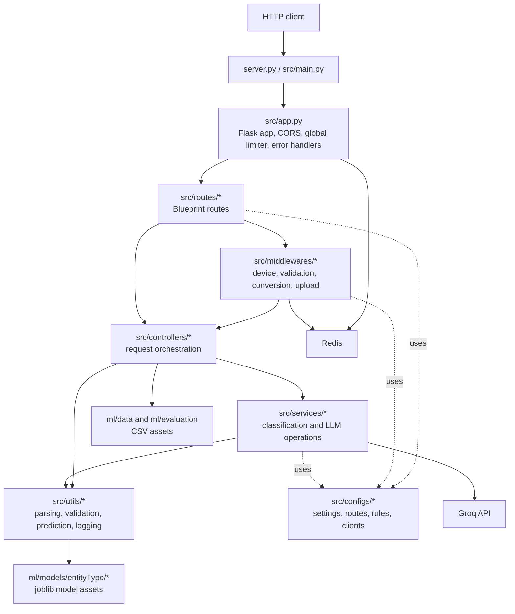
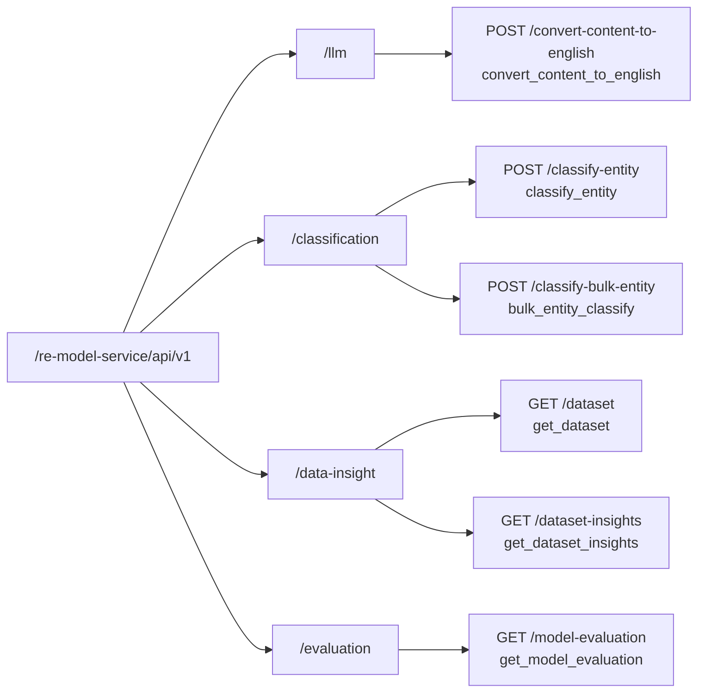
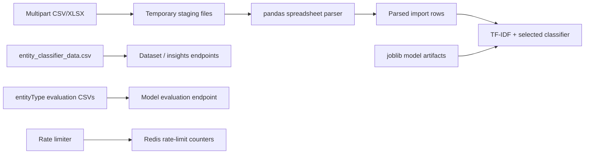
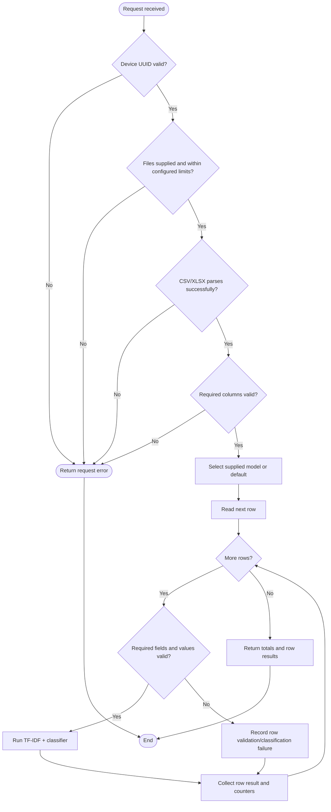
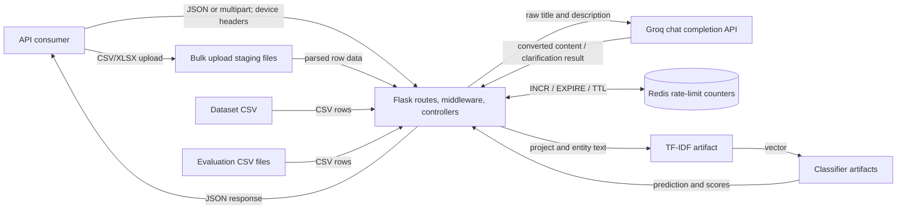
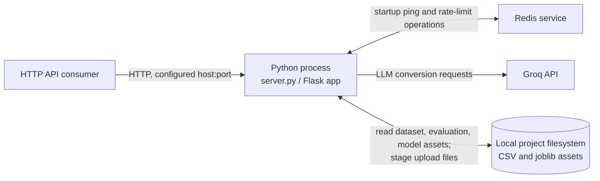

# Software Design Document

## RE AI Model Service

**Document type:** Software Design Document (SDD)  
**Service:** RE AI Model Service  
**Version:** 1.0  
**Date:** 19 October 2026  
**Implementation scope:** Backend service only

---

## Table of Contents

1. [Introduction](#1-introduction)
2. [Service Overview](#2-service-overview)
3. [Architecture and Module Design](#3-architecture-and-module-design)
4. [Router and API Design](#4-router-and-api-design)
5. [Function-Level Design](#5-function-level-design)
6. [Database and Data Asset Design](#6-database-and-data-asset-design)
7. [Sequence Diagrams](#7-sequence-diagrams)
8. [Activity Diagram](#8-activity-diagram)
9. [Data Flow Diagram](#9-data-flow-diagram)
10. [Security Design](#10-security-design)
11. [Error Handling and Logging](#11-error-handling-and-logging)
12. [Configuration and External Dependencies](#12-configuration-and-external-dependencies)
13. [Deployment and Integration](#13-deployment-and-integration)
14. [Design Constraints, Assumptions and Limitations](#14-design-constraints-assumptions-and-limitations)
15. [Summary](#15-summary)
16. [Unverified Information](#16-unverified-information)

## List of Figures

| Figure | Caption |
|---|---|
| 1 | Backend module/component structure |
| 2 | Route-to-handler mapping |
| 3 | Single entity classification sequence |
| 4 | Bulk classification sequence |
| 5 | Bulk import activity flow |
| 6 | Backend data flow |
| 7 | Verified deployment and runtime relationships |
| 8 | File-backed data asset model |

## List of Tables

| Table | Caption |
|---|---|
| 1 | Backend technology stack and dependencies |
| 2 | Backend folder responsibilities |
| 3 | Implemented endpoint inventory |
| 4 | Request fields and validation |
| 5 | Response and error status patterns |
| 6 | Data files and model artifacts |
| 7 | Configuration variables |
| 8 | External integrations |

---

## 1. Introduction

### 1.1 Purpose

This document describes the implemented backend architecture, interfaces, processing flows, data assets, integrations and operating constraints of the RE AI Model Service. It is based on the Python source and configuration present in the repository. The frontend is outside this document's scope.

### 1.2 Scope

The service exposes HTTP APIs for:

- Normalizing/ translating raw requirement content into English using an LLM provider.
- Classifying an entity against project context using serialized machine-learning models.
- Classifying rows imported from spreadsheet files.
- Returning the training dataset, summary insights and saved evaluation CSVs.

The service also performs device-header validation, CORS handling, global request limiting and device-based limiting on selected error paths.

### 1.3 Service responsibilities

The backend accepts JSON or multipart requests, applies middleware checks, executes controller/service functions, reads model and CSV assets from the local project filesystem, invokes Redis for rate limiting, optionally invokes Groq for text conversion, and returns JSON responses.

The implementation does not establish a general-purpose persistence layer for application records. Redis is used by the rate limiters; it is not used as the system of record for classification results or dataset content.

## 2. Service Overview

### 2.1 Main features and responsibilities

| Capability | Implemented behavior |
|---|---|
| Content conversion | Calls Groq's chat completion API with a system prompt and requests a JSON object. The result contains converted title, description, and a clarification flag. |
| Single classification | Converts raw title/description through LLM middleware, combines the converted content with project context, transforms it with a saved TF-IDF vectorizer, then predicts with a selected classifier. |
| Bulk classification | Accepts uploaded CSV/XLSX file(s), parses their rows, validates headers and row data, and classifies each valid row. |
| Dataset retrieval | Reads `ml/data/entity_classifier_data.csv` and returns its rows. |
| Dataset insights | Computes record counts, category distributions, missing-field counts, average lengths, duplicate rows and unique title/project counts from the same CSV. |
| Model evaluation data | Reads CSV files present in `ml/evaluation/entityType` and returns their rows keyed by file basename. |
| Rate limiting | Applies a Redis-backed global limiter to incoming requests. Device-based Redis limiters are applied to malformed JSON and unknown-route responses. |

### 2.2 Technology stack

**Table 1. Backend technology stack and dependencies**

| Technology/dependency | Role evidenced by source or manifest |
|---|---|
| Python | Backend runtime and module language. |
| Flask | WSGI application, request handling, routing through Blueprints, JSON responses and error handlers. |
| scikit-learn | Model prediction and TF-IDF feature transformation. |
| joblib | Loading serialized TF-IDF and classifier artifacts. |
| pandas | Reading CSV and Excel uploads for bulk classification. |
| Redis / `redis` Python package | Counter, expiry and TTL operations for rate limiting; startup connectivity check. |
| Groq Python SDK (`groq`) | Active LLM integration used by `llm_service.py`. |
| `python-dotenv` | Loads environment variables from dotenv configuration. |
| NumPy | Listed dependency and used to inspect decision-score dimensions in prediction output handling. |
| Gunicorn | Listed dependency; no repository deployment command/configuration was found to verify its use. |
| `openai`, `google-genai`, `mistralai` | Listed dependencies with client factory modules; active route/service flows reviewed here use Groq, not those other clients. |

The dependency file is [requirements.txt](../requirements.txt). It does not pin dependency versions.

## 3. Architecture and Module Design

### 3.1 High-level service structure

The backend follows a function/module-oriented design. Flask Blueprints map routes to functions; route functions execute ordered middleware functions and then controllers. Controllers call service and utility functions. Configuration modules provide route names, validation rules, model names and client construction.

**Figure 1. Backend module/component structure**



The diagram shows logical dependencies, not separate deployable processes. The controllers and service modules execute in the Flask application process. Redis and the Groq API are external runtime dependencies.

### 3.2 Folder and module responsibilities

**Table 2. Backend folder responsibilities**

| Location | Responsibility |
|---|---|
| `server.py` | Loads dotenv configuration, initializes the application and exposes the Flask app. Direct execution calls `app.run` with configured host/port and debug enabled. |
| `src/app.py` | Constructs the Flask app; installs CORS, global limiter and JSON parsing check; registers malformed JSON/404 handlers and routes. |
| `src/main.py` | Performs a Redis connectivity check in `initialize_application()` and returns the Flask app. |
| `src/routes/` | Registers four Blueprints and maps six HTTP routes to route functions. |
| `src/middlewares/` | Device-header verification, required-field and value validation, translation, model selection, file upload/parsing and header validation. |
| `src/middlewares/factory/` | Higher-order functions that produce reusable middleware functions for body validation, enum defaults, uploads and file parsing. |
| `src/controllers/` | Request-level orchestration and response selection for classification, data insights, evaluation and conversion. |
| `src/services/` | Entity classification logic and Groq-backed text processing. |
| `src/responses/` | JSON success-response builders and shared error-response builders. |
| `src/configs/` | Route prefixes, field definitions, validation rules, enums, provider/client factories, upload settings, status codes and prompts. |
| `src/rate_limiters/` | Redis-backed global and device-specific limiters. |
| `src/utils/` | Field/enum validation, CSV/spreadsheet parsing, prediction score formatting, temporary-file handling, environment conversion and logging. |
| `ml/models/entityType/` | Serialized TF-IDF vectorizer and classifier artifacts loaded by the classification service. |
| `ml/data/` | Training dataset CSV exposed by data endpoints. |
| `ml/evaluation/entityType/` | Evaluation CSV artifacts exposed by the evaluation endpoint. |
| `src/uploads/temp/bulk-imports/` | Temporary staging area used by bulk file upload configuration. |

No meaningful application class hierarchy was found; a UML class diagram is therefore not applicable.

### 3.3 Router/API mapping

**Figure 2. Route-to-handler mapping**



The prefix and route suffixes are sourced from `src/configs/uris.py`; Blueprints are mounted in `src/routes/index.py`.

## 4. Router and API Design

### 4.1 Implemented endpoint inventory

All endpoints require the `x-device-uuid` request header to pass route-level device validation. The UUID must be a valid UUID version 4. Device name and device type headers are optional; when supplied, they are validated. No bearer-token validation or user authorization middleware is wired into these routes.

**Table 3. Implemented endpoint inventory**

| Method and full path | Route function / controller | Route middleware and processing |
|---|---|---|
| `POST /re-model-service/api/v1/llm/convert-content-to-english` | `convert_content_to_english` → `convert_content_to_english_controller` | `verify_device_field` → required fields → field validation → controller → `process_text` |
| `POST /re-model-service/api/v1/classification/classify-entity` | `classify_entity` → `classify_entity_controller` | `verify_device_field` → required fields → field validation → `convert_content_to_english_middleware` → `set_entity_model_middleware` → controller → `classify_entity` |
| `POST /re-model-service/api/v1/classification/classify-bulk-entity` | `bulk_entity_classify` → `import_entity_type_controller` | `verify_device_field` → file upload → spreadsheet parser → required-column check → `set_entity_model_middleware` → controller row validation and classification |
| `GET /re-model-service/api/v1/data-insight/dataset` | `get_dataset` → `get_dataset_controller` | `verify_device_field` → read dataset CSV |
| `GET /re-model-service/api/v1/data-insight/dataset-insights` | `get_dataset_insights` → `get_dataset_insights_controller` | `verify_device_field` → read dataset CSV and compute metrics |
| `GET /re-model-service/api/v1/evaluation/model-evaluation` | `get_model_evaluation` → `get_model_evaluation_controller` | `verify_device_field` → read evaluation CSV files |

Global application processing also runs CORS handling, the global Redis rate limiter and Flask JSON parsing validation before route execution. Flask cookie access is available, but no cookie-based authentication is implemented.

### 4.2 Request formats and validation

**Table 4. Request fields and validation**

| Endpoint | Body/form fields verified from source | Validation |
|---|---|---|
| LLM conversion | JSON: `rawTitle` required; `rawDescription` optional. | Title length 3–200 characters; description length 10–2000 characters when supplied. |
| Single classification | JSON project context: `projectTitle`, `projectDescription`, `problemStatement`, `projectGoal`, `projectType`; optional `productVision`; entity input uses `rawTitle` and optional `rawDescription`. | Project title 3–150 chars; descriptions/problem statement 10–2000; goal 10–1000; project type one of `development`, `enhancement`, `maintenance`; product vision 20–5000 if present; raw title 3–200; raw description 10–2000 if present. The raw entity title/description are converted by middleware before prediction. |
| Bulk classification | Multipart form field `file` (multiple files supported); optional multipart `model` field. | Upload configuration accepts `.csv` and `.xlsx`, max 10 files and 20 MB each by defaults, configurable by environment variables. Header names must cover the required import fields. Row fields are validated independently. |
| Dataset, insights, evaluation | No request body fields are read. Device headers still apply. | GET route-level device header validation. |

The default model is `linear_svm`. The model middleware uses the default when the model is omitted or invalid, rather than returning a validation error. Valid model identifiers are `linear_svm`, `sgd_classifier`, `ridge_classifier`, `logistic_regression`, `complement_naive_bayes`, `bernoulli_naive_bayes`, `multinomial_naive_bayes`, `extra_trees`, `random_forest`, and `decision_tree`.

Bulk import row schema is defined by `IMPORT_ENTITY_TYPE`: required `rowId`, `projectTitle`, `projectDescription`, `problemStatement`, `projectGoal`, `projectType`, and `entityTitle`; optional `productVision` and `entityDescription`. Required headers are derived from this field definition. A row ID is required but no persistence or uniqueness enforcement for it is implemented.

**Note:** The classification field definition maps `rawTitle`/`rawDescription` as entity input; its controller receives project fields from the JSON body but takes the entity title/description from converted request data. The behavior described above reflects the middleware/controller flow rather than an inferred API schema.

### 4.3 Request and response shapes

The success response functions consistently return JSON with a `success` boolean, a message, and endpoint data. The verified response shapes are:

- Conversion: `data.title`, `data.description`, `data.need_clarification`.
- Single classification: `data.title`, `data.description`, `data.entityType`, `data.score`, `data.scoreType`, `data.classScores`.
- Bulk classification: `data.totalRows`, `data.validRows`, `data.invalidRows`, `data.rows`. Each row contains the original fields plus `isValid`, `invalidReason`, and `modelOutput`; successful model output contains prediction and score-related fields.
- Dataset and insights: `data` is respectively an array of CSV row objects or an insights object.
- Model evaluation: `data` is an object keyed by evaluation CSV basename, each key containing parsed row objects.

The implementation does not define a formal OpenAPI specification. The exact payload shapes above are taken from request field definitions, controllers and response builders.

### 4.4 Authentication and authorization

There is no user login, access-token verification, role check or authorization policy on these endpoints in the reviewed route/middleware path. A valid device UUID is mandatory but it identifies a device request context; it is not proof of user identity or authorization.

## 5. Function-Level Design

### 5.1 Request lifecycle and middleware

For normal requests, the Flask app runs CORS preflight/allowlist handling, the global limiter, then JSON parsing validation. A route function runs its middleware functions in listed order and returns immediately when a middleware returns a response. Successful middleware commonly writes derived data to Flask's request object, for example `request.device`, `request.converted_content`, `request.entity_model`, `request.uploaded_files`, and `request.import_data`.

### 5.2 Important functions

| Function | Inputs | Outputs / side effects | Validation and failure behavior |
|---|---|---|---|
| `register_routes(app)` | Flask app | Registers four Blueprints at configured prefixes. | No request processing. |
| `verify_device_field()` | `x-device-uuid`, optional `x-device-name`, `x-device-type` headers | Stores normalized values in `request.device`; returns `None` on success. | UUID v4 required; name length 3–100; device type must match configured enum; returns structured 400/422/500 response on error. |
| `create_global_limiter()` / `global_limiter()` | Redis, request IP/path, configured limits | Increments per-IP key and sets expiry on first hit; returns `None` under limit or JSON 429 with optional `Retry-After`. | Redis/setup errors are logged; request-time errors return 500; initializer failure creates a limiter that returns 500. |
| `create_redis_device_rate_limiter(config)` | Limiter config, request and continuation callback | Returns higher-order limiter function; increments per-device key and invokes callback under limit. | Exceeding the configured limit returns 429; Redis errors return 500. Used on malformed JSON and unknown paths. |
| `create_enum_default_middleware(name, enum_helper)` | Enum helper; request body/form `model` | Returns middleware that stores selected model in `request.entity_model`. | Missing/invalid model falls back to enum default (`linear_svm`). |
| `convert_content_to_english_middleware()` | JSON `rawTitle`, `rawDescription` | Calls `process_text`; stores converted title/description on request. | Clarification required yields 400; provider/processing exceptions use internal error handling. |
| `classify_entity_controller()` | Validated JSON, `request.converted_content`, `request.entity_model` | Calls `classify_entity` and builds the classification response. | Missing derived model/content or other exceptions become logged 500 responses. |
| `classify_entity(...)` | Project fields, entity fields, model identifier | Joins text, vectorizes via TF-IDF, loads/caches chosen model and returns prediction information. | Unknown model identifier raises `ValueError`; callers handle errors. |
| `get_model(model_name)` | Identifier from `MODEL_PATHS` | Loads and memoizes a joblib classifier in module-level `models`. | Unknown identifier raises `ValueError`; file/load errors propagate. |
| `get_model_prediction(model, text_vector)` | Scikit-learn model and vector | Returns prediction, score, score type, and class scores where supported. | Uses `predict_proba`, otherwise `decision_function`, otherwise null score fields. |
| `import_entity_type_controller()` | Parsed rows in `request.import_data`, selected model | Validates each row, classifies valid rows and returns row counts/results. | Field validation errors are included per row; classification exceptions mark that row invalid; unexpected controller failures return 500. |
| `parse_spreadsheet(file_path, extension)` | Staged file path and extension | Returns `{success, parser, data}` with headers, rows and optional sheet name. | Unsupported format, invalid/empty file or parser exceptions return failure result for middleware to convert into 400. |
| `process_text(raw_title, raw_description)` | Strings from request | Calls Groq completion with system/user prompts and JSON response format; returns decoded object with boolean `need_clarification`. | API, parsing and response errors propagate to controller or middleware error handling. |
| `get_dataset_controller()` / `get_dataset_insights_controller()` | Local dataset CSV | Returns parsed rows or computed summary metrics. | File/processing errors are logged and returned as 500. |
| `get_model_evaluation_controller()` | Local evaluation directory | Reads `.csv` files into a mapping keyed by filename stem. | File/directory errors are logged and returned as 500. |

### 5.3 Factory functions and composition

The implementation uses higher-order functions and closures, not a class-centric middleware model. `check_body_presence`, `validate_body`, `create_enum_default_middleware`, `create_file_upload_middleware`, and `create_parse_file_middleware` return request-time functions configured with field rules or upload settings. Route functions compose these closures in explicit Python lists and short-circuit at the first response.

## 6. Database and Data Asset Design

### 6.1 Database technology and persistence

No relational or document database schema, ORM models, migrations, or application-record persistence layer was found in the backend source. Redis is an external key-value service used for rate-limit counters and expiry only. The service's principal content and model data are filesystem assets.

Consequently, an ER diagram for application entities is not applicable. The following file-backed data model shows the sources and their consumers.

**Table 6. Data files and model artifacts**

| Asset | Format | Use |
|---|---|---|
| `ml/models/entityType/entity_tfidf.joblib` | joblib serialized transformer | Converts composed project/entity text to a TF-IDF vector. |
| `ml/models/entityType/entity_<model>.joblib` | joblib serialized classifier | Predicts an entity type. Ten model identifiers map to files. |
| `ml/data/entity_classifier_data.csv` | CSV | Dataset API and dataset-insights API source. |
| `ml/evaluation/entityType/*.csv` | CSV | Evaluation API source; all files ending in `.csv` in that directory are returned. |
| `src/uploads/temp/bulk-imports/_staging/` | Temporary CSV/XLSX files | Staging location for bulk imports before parsing. |
| Redis keys | Key-value counters with expiry | Global per-IP and selected error-path per-device request limits. |

No indexes or database constraints apply to these filesystem/Redis assets as database structures. Redis limiter keys receive an expiration when their counter is first incremented.

**Figure 8. File-backed data asset model**



### 6.2 Dataset insight calculations

The insights controller derives counts and descriptive metrics from the dataset CSV at request time. It computes category distributions, unique project/entity title counts, average records per project, missing-field counts, average non-empty field lengths and duplicate row count. The results are not shown being stored.

## 7. Sequence Diagrams

### 7.1 Single entity classification

**Figure 3. Single entity classification sequence**

```mermaid
sequenceDiagram
    participant C as Client
    participant A as Flask app
    participant R as classification route
    participant D as verify_device_field
    participant V as Required/value validation
    participant L as convert_content_to_english_middleware
    participant G as Groq API via process_text
    participant M as set_entity_model_middleware
    participant H as classify_entity_controller
    participant S as classification_service
    participant T as TF-IDF / joblib model

    C->>A: POST /classification/classify-entity + JSON + device header
    A->>A: CORS, global Redis limiter, JSON parse check
    A->>R: Dispatch request
    R->>D: Validate and store device context
    D-->>R: Continue or error response
    R->>V: Check required fields and validation rules
    V-->>R: Continue or error response
    R->>L: Convert raw title/description
    L->>G: Chat completion (JSON response requested)
    G-->>L: Converted title, description, clarification flag
    alt Clarification required
        L-->>C: 400 response
    else Content accepted
        L-->>R: Store converted content in request
        R->>M: Select model or apply default
        M-->>R: Store model identifier in request
        R->>H: Execute controller
        H->>S: classify_entity(project context, converted content, model)
        S->>T: TF-IDF transform; predict and derive scores
        T-->>S: Prediction and score data
        S-->>H: Classification result
        H-->>C: 200 JSON success response
    end
```

The shown sequence follows the actual route middleware order. The LLM is called before classification and can stop the flow when it signals that clarification is needed.

### 7.2 Bulk classification

**Figure 4. Bulk classification sequence**

```mermaid
sequenceDiagram
    participant C as Client
    participant A as Flask app
    participant R as classification route
    participant D as verify_device_field
    participant U as File upload middleware
    participant P as Parse middleware / pandas
    participant V as Required-column middleware
    participant M as Model selection middleware
    participant H as import_entity_type_controller
    participant S as classification_service
    participant F as Filesystem model assets

    C->>A: POST multipart file(s), optional model and device header
    A->>A: CORS, global Redis limiter
    A->>R: Dispatch request
    R->>D: Validate device
    D-->>R: Continue or error response
    R->>U: Validate count, size, extension, MIME; stage file(s)
    U-->>R: Store uploaded file metadata
    R->>P: Parse CSV/XLSX into headers and rows
    P-->>R: Store request.import_data
    R->>V: Check required columns
    V-->>R: Continue or error and staged-file cleanup
    R->>M: Read model or default to linear_svm
    M-->>R: Store model identifier
    R->>H: Process rows
    loop Each row
        H->>H: Validate required fields, lengths and enum values
        alt Valid row
            H->>S: classify_entity(row context, selected model)
            S->>F: Load/cache TF-IDF and classifier artifacts
            F-->>S: Model prediction
            S-->>H: Prediction scores
        else Invalid row
            H->>H: Record validation reason; omit prediction
        end
    end
    H-->>C: 200 JSON totals and row results
```

Bulk classification does not call the LLM text-conversion service. Rows classified successfully have model results included; invalid rows carry a reason and a not-applicable model output.

## 8. Activity Diagram

### 8.1 Bulk import processing

**Figure 5. Bulk import activity flow**



The diagram represents validation and per-row classification decisions implemented in the upload middleware and bulk controller. It does not imply durable import-job state; no such job store is present.

## 9. Data Flow Diagram

### 9.1 Backend data movement

**Figure 6. Backend data flow**



The data flow shows only integrations evidenced by active backend code. The Groq API receives the request's raw content through `process_text`; the API key is obtained from configuration and is not part of the payload shown here.

## 10. Security Design

### 10.1 Implemented controls

- **Device header validation:** all six route functions call `verify_device_field`; `x-device-uuid` must be valid UUID v4. Optional device name and device type are validated.
- **Input validation:** required fields, string lengths, project-type enum values, spreadsheet required headers and row values are checked.
- **Upload checks:** maximum file count, file size, allowed extension and MIME type are checked before staging. Generated staged filenames use a timestamp and random numeric suffix rather than the client-provided basename.
- **CORS:** a fixed list of local development origins and the configured `FRONTEND_URL` are allowed; credentials are enabled for allowed origins.
- **Rate limiting:** Redis counters limit global requests by observed remote address and apply per-device limits for malformed JSON and unknown routes.
- **Secret handling:** provider and Redis credentials are read from environment variables. This document lists variable names only and does not reproduce values.
- **Temporary file cleanup:** upload and parse failures invoke cleanup helpers for staged uploads.

### 10.2 Authentication and authorization status

No authentication or authorization mechanism is implemented in the reviewed request path. CORS and the device UUID header do not constitute authentication. Token-related strings are present in the CORS allow-headers list, but no active token validation middleware was found attached to these routes.

### 10.3 Security limitations

- The global limiter key is based on `request.remote_addr` first; proxy-header trust/configuration is not documented.
- Device identifiers are caller-provided values and are not backed by an authentication step.
- The repository does not document production TLS termination, secret management, network policy, file retention policy or operational access controls.
- The Flask development entry point runs with debug enabled; this is not evidence that production should use debug mode.

## 11. Error Handling and Logging

### 11.1 Error responses

**Table 5. Response and error status patterns**

| Condition | HTTP status / response behavior |
|---|---|
| Success | `200`, JSON response with `success: true`, message and data. |
| Missing required fields / malformed JSON | `400`; missing-field response includes fields, malformed JSON handler returns `code: MALFORMED_JSON` and message. |
| Invalid device type / file input or parser/header errors | Usually `400`; invalid structured field values use `422`. |
| Invalid UUID | `422` validation error. |
| Unknown route | `404` response with `code: UNKNOWN_ROUTE`, unless device-based limiter returns `429` or internal failure. |
| Rate limit exceeded | `429` JSON response; limiter adds `Retry-After` when Redis TTL is positive. |
| Unexpected controller, service or dependency error | `500` JSON error response through shared handlers or limiter-specific error JSON. |
| LLM ambiguity | `400` response indicating clarification is required. |

Not every status helper defined in the shared response module is used by the six active routes. The table summarizes observed request-path behavior, not every reusable helper constant.

### 11.2 Logging

Logging is implemented through timestamped `print` calls in `src/utils/time_stamps.py`, with error details and middleware events logged by `src/utils/log_error.py`. Logs include success/failure messages and some request/device context. No structured logging framework, centralized log sink, configurable log level or request correlation implementation was verified.

## 12. Configuration and External Dependencies

### 12.1 Environment variables

**Table 7. Configuration variables**

| Variable | Purpose |
|---|---|
| `HOST` | Flask bind host; default defined as `0.0.0.0`. |
| `PORT` | Flask bind port; default defined as `8083`. |
| `FRONTEND_URL` | Additional allowed CORS origin. |
| `RATE_LIMIT_WINDOW` | Global rate-limit window in minutes; default `10`. |
| `RATE_LIMIT_MAX` | Maximum global requests per key/window; default `100`. |
| `REDIS_HOST` | Required Redis host. |
| `REDIS_PORT` | Redis port; default `6379`. |
| `REDIS_DB` | Redis database index; default `0`. |
| `REDIS_PASSWORD` | Redis password input used in the client URL; value intentionally not documented. |
| `REDIS_TLS` | Enables `rediss` URL scheme when set to `true` (case-insensitive). |
| `GROQ_API_KEY` | Required by the active Groq client factory. |
| `GEMINI_API_KEY` | Required only by the Gemini client factory module; no active API route use was found. |
| `MISTRAL_API_KEY` | Required only by the Mistral client factory module; no active API route use was found. |
| `OPENROUTER_API_KEY` | Required only by the OpenRouter client factory module; no active API route use was found. |
| `ENTITY_TYPE_IMPORT_MAX_FILES` | Maximum bulk import file count; default `10`. |
| `ENTITY_TYPE_IMPORT_MAX_FILE_SIZE_MB` | Per-file upload limit in MiB; default `20`. |

`python-dotenv` loads dotenv configuration. No values from environment or dotenv files are included in this document.

### 12.2 External integrations

**Table 8. External integrations**

| Integration | Active use |
|---|---|
| Redis | Startup ping and rate-limit counters with expiration/TTL behavior. |
| Groq | LLM request through `groq` SDK in `src/services/llm_service.py`. The configured model identifier is `openai/gpt-oss-120b`. |
| Gemini, Mistral, OpenRouter | Client construction modules and dependency declarations exist. No call from active route/service execution was identified in the reviewed source. |
| Local files | Read access to joblib model artifacts, dataset CSV, evaluation CSVs and staged upload files. |

## 13. Deployment and Integration

### 13.1 Verified runtime entry and port

The direct development entry point is `server.py`. It loads dotenv configuration, calls `initialize_application()`, and when executed directly invokes Flask `app.run(host=HOST, port=PORT, debug=True)`. The settings module defaults to host `0.0.0.0` and port `8083`.

Startup calls `get_redis_client()` and pings Redis. Redis is therefore a startup dependency. The rate limiter modules also create Redis clients during module initialization. The active LLM flow requires a valid Groq API key and connectivity when the conversion endpoint is used.

### 13.2 Verified integration topology

**Figure 7. Verified deployment and runtime relationships**



The repository has a Gunicorn dependency but does not provide a verified production launch command, container definition, orchestration manifest or deployment topology. Such details are intentionally not inferred.

## 14. Design Constraints, Assumptions and Limitations

1. Classification depends on the serialized joblib assets being present at the expected `ml/models/entityType` paths and compatible with the installed scikit-learn version.
2. Classification and insights are synchronous request/response operations. Bulk rows are processed sequentially in the controller; no queue or asynchronous job mechanism was found.
3. Dataset and evaluation results are read from local CSV files at request time; no external data store or snapshot/version management was verified.
4. Redis is required for startup and rate limiting. There is no documented fallback mode for absent Redis.
5. The LLM conversion endpoint and single classification endpoint depend on external Groq availability. Bulk classification does not use this LLM conversion path.
6. Upload configuration accepts `.csv` and `.xlsx`; the parser also supports `.xls`, but `.xls` is not allowed by the active upload configuration.
7. The multipart upload defaults are configurable, but malformed/non-integer values for these two settings fall back to defaults through `get_my_env_as_number`.
8. Several other provider factories and corresponding package dependencies exist but were not found in active route workflows.
9. No API schema document, formal database schema, migration set, integration-test results or verified production deployment configuration was found during inspection.
10. The checked-in `server.py` development path enables Flask debug mode. Production behavior is unverified.
11. The root `README.md` contains no implementation documentation; backend facts in this document were taken from code and dependency declarations.

## 15. Summary

The RE AI Model Service is a Flask backend with explicit Blueprint routing, function-based request middleware, controller orchestration and service/helper modules. Its core business flow combines optional Groq-based normalization with TF-IDF and serialized scikit-learn classification models. Bulk uploads are parsed and classified synchronously. Dataset and evaluation endpoints serve filesystem-backed CSV content; Redis supports rate limiting rather than domain persistence. Device UUID validation and input checks are present, while user authentication and authorization are not implemented in the reviewed routes.

## 16. Unverified Information

The following details could not be established from the repository source reviewed:

- The production WSGI server command, hosting platform, container/orchestration setup and TLS termination.
- Redis deployment/HA, eviction policy, retention configuration or operational credentials management.
- Whether all locally present model artifacts are used in deployed environments, and the training process/reproducibility guarantees for the active artifacts.
- The exact external Groq service behavior, availability guarantees and account-level configuration.
- A formal API contract beyond the implementation-level fields and response builders documented here.
- Whether intended production clients use authentication in an upstream gateway not included in this service repository.

---

**End of document**
